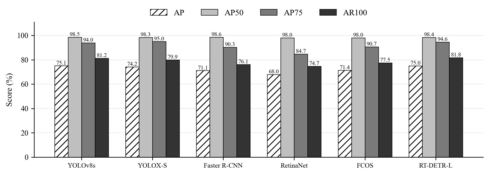

# Pig Detection 猪只目标检测

在单类别猪只图像上比较六种目标检测算法，提供统一 COCO 评测、训练曲线和自动生成的可视化报告。

[快速开始](#快速开始) · [自动可视化](#自动可视化) · [实验结果](#实验结果) · [数据集](#数据集) · [数据清洗](#数据清洗) · [项目结构](#项目结构) · [复现说明](#复现说明)

## 项目简介

YOLOv8s、YOLOX-S、Faster R-CNN、RetinaNet、FCOS 和 RT-DETR-L 的服务器实验已完成，每种方法均训练100轮并完成统一测试。原始记录与模型已迁回本机，实际项目位置为 `D:\Projects\Pig_Detection_test`。

当前结果来自 RTX 3090、seed=42、目标有效 batch=32 的服务器批次。项目根目录的默认配置沿用本机方案：40轮、batch=4、有效batch=4；两套方案分开保存，不能把下面的100轮结果写成本机40轮的成绩。

## 快速开始

VSCode 打开本项目，在终端手动激活环境后运行：

```powershell
conda activate pigdet
python train.py
```

该命令从官方初始化权重开始新建本机40轮批次，依次完成六模型训练、统一测试、CSV汇总、训练曲线和测试图表。已有结果不会被覆盖，入口不自动切换环境或安装依赖。

仅检查配置与输入：

```powershell
python train.py --check
```

沿用服务器100轮预算（需要相应显存）：

```powershell
python train.py --profile server_100
```

`server_100` 使用记录中的训练轮数和batch预算，并沿用当前批量保护；原服务器实际执行过的源码与环境快照另行保存在 provenance 中。当前代码不承诺与历史服务器逐位一致，内部验证batch也可能不同。

## 自动可视化

`python train.py` 已在测试后接入报告阶段。图表生成成功后才会把流程标记为完成。

```text
数据校验 → 六模型训练与验证选权重 → 测试 → 统一COCO表 → 自动图表与HTML报告
```

| 自动输出 | 内容 |
| --- | --- |
| 测试指标图 | AP、AP50、AP75、AR100 |
| 验证曲线 | 六模型统一 pycocotools AP与最佳轮次 |
| 训练损失 | 各模型独立子图，保留原生尺度 |
| PR曲线 | IoU=0.50与0.75，读取已保存预测重算 |
| 耗时与精度图 | batch=1适配器耗时，不含磁盘解码 |
| 目标尺度图 | 中、大目标AP，无定义指标明确标注 |
| 查看入口 | HTML、Markdown；图形同时保存PNG/PDF/SVG |

**当前结果：[HTML总报告](experiments/work_dirs/report/index.html) · [结果汇总](experiments/work_dirs/report/结果汇总.md) · [原精度CSV](experiments/work_dirs/report/comparison.csv)**



新批次输出为 `experiments/records/<批次号>/report/index.html`。只重建现有图表、无需训练或推理：

```powershell
python tools/build_experiment_report.py
```

绘图实现见 [evaluation/visual_report.py](evaluation/visual_report.py)。PR阶段会核对重算AP与原始测试指标一致。

## 实验结果

100轮服务器实验；AP等指标为百分数。测试集为133张图片、1,289个框，使用验证集COCO AP选择各模型最佳权重。

| 方法 | AP | AP50 | AP75 | AR100 | 平均 ms/图 |
| --- | ---: | ---: | ---: | ---: | ---: |
| YOLOv8s | 75.09 | 98.48 | 93.97 | 81.19 | 3.41 |
| YOLOX-S | 74.16 | 98.34 | 95.01 | 79.93 | 4.82 |
| Faster R-CNN | 71.13 | 98.58 | 90.31 | 76.11 | 13.66 |
| RetinaNet | 67.99 | 98.03 | 84.70 | 74.68 | 12.34 |
| FCOS | 71.40 | 98.03 | 90.69 | 77.52 | 12.85 |
| RT-DETR-L | 75.00 | 98.39 | 94.63 | 81.76 | 19.00 |


YOLOv8s的AP为75.09%，RT-DETR-L为75.00%，仅相差0.09个百分点；没有多种子或显著性证据。Faster R-CNN的AP50最高，YOLOX-S的AP75最高，RT-DETR-L的AR100最高，说明宽松匹配、严格定位与召回排序不同。

耗时来自RTX 3090上batch=1、剔除首张预热后132张的均值，包含适配器预处理、模型和后处理，不含磁盘解码；不能直接当作论文端到端FPS。

| 方法 | 实际训练batch | 配置有效batch | 训练轮数 |
| --- | ---: | ---: | ---: |
| YOLOv8s | 32 | 32 | 100 |
| YOLOX-S | 16 | 32 | 100 |
| Faster R-CNN | 8 | 32 | 100 |
| RetinaNet | 32 | 32 | 100 |
| FCOS | 16 | 32 | 100 |
| RT-DETR-L | 16 | 32 | 100 |

目标有效batch一致不代表微批和BatchNorm统计相同；尾部小批次也不保证每次更新正好32张。原生预处理、损失及初始化检测头不同，本项目是统一数据和预算下的实现比较，不是各论文原配方复现。

## 数据集

| 划分 | 图片 | 标注框 | 用途 |
| --- | ---: | ---: | --- |
| train | 690 | 6,577 | 更新模型参数 |
| val | 112 | 1,088 | 每轮统一评测并选择最佳权重 |
| test | 133 | 1,289 | 最佳权重的最终比较 |
| excluded | 80 | 781 | 分界隔离，保留raw，不参与本版实验 |

按数字文件名分块，在两处分界的两侧各隔离20张。文件编号尚未证明是真实时间或来源分组，因此属于同场景内部探索性验证，不能据此宣称无语义泄漏或跨场景泛化。测试集中大目标1,285个、中目标仅4个、无小目标；`AP_small=-1`表示无定义。

原始图像、XML、COCO/YOLO派生数据、初始化及训练权重保留在本机，不上传公开仓库。数据清单位于 `data/splits/`；派生格式位于 `data/processed/exploratory/`。从GitHub复现时需自行提供同版本原始数据，再按手册转换。

## 数据清洗

本机数据位于 `D:\Projects\Pig_Detection_test\data\raw\pig_detection`，其中 `data/` 存放 JPG，`label/` 存放同名 VOC XML。原包共有 2,016 张图片、1,015 份 XML；当前保留 1,015 对文件、9,735 个 pig 标注框，图像分辨率均为 1280×720。

1. 按确认过的清单删除 1,001 张含猪但无同名 XML 的图片，没有将其当作背景负样本。
2. 原 110 组完全重复图片在上述删除中处理完毕：109 组保留有标注版本，另 1 组两张均无标注，全部删除。当前图片 SHA256 均不同；这不证明不存在语义近重复。
3. 将 XML 的 `path` 改为当前真实 JPG 路径、`folder` 改为 `data`。除这两个字段外，类别与框坐标保持不变。

清洗清单与路径修复记录在 `data/audit/`；历史审计仅描述对应时点，XML 路径修改会改变文件哈希。原始图片备份由用户保留的压缩包提供。

## 项目结构

```text
Pig_Detection_test/
├── configs/                  # 默认本机40轮配置及server_100历史预算
├── data/                     # 原图、XML、清洗审计、固定划分和COCO/YOLO派生数据
├── datasets/                 # COCO读取与模型原生预处理接口
├── docs/                     # 实验手册、运行说明、目录说明、Word实验报告
├── evaluation/               # 统一COCO评测及自动图表报告代码
├── experiments/
│   ├── work_dirs/
│   │   ├── baseline/<method>/training/   # 已完成100轮训练记录和权重
│   │   ├── baseline/<method>/test/       # 六模型metrics.json和predictions.json
│   │   └── report/                      # 当前图表、HTML、Markdown和CSV
│   ├── records/              # 以后每次python train.py独立生成的新批次
│   ├── environment/          # 本机环境清单
│   ├── provenance/           # 迁移凭据、原始历史记录和服务器源码快照
│   └── final_results.json    # 当前六模型的实际路径和哈希索引
├── losses/                   # 原生损失说明
├── models/                   # 模型适配器及本地初始化权重
├── scripts/                  # 单模型训练和预测导出入口
├── tools/                    # 数据转换、校验、下载、报告和第三方YOLOX源码
├── train.py
├── requirements.txt
└── README.md
```

六个完成结果目录各有 `training/` 与 `test/`，统一入口为 `experiments/final_results.json`。旧失败记录和批量探测文件已移出当前项目归档。详细说明见 [项目文件结构说明](docs/项目文件结构说明.md)。

## 复现说明

已完成服务器实验使用PyTorch 2.5.1+cu121、torchvision 0.20.1+cu121、Ultralytics 8.4.183和NumPy 1.26.4。服务器pip清单见 [requirements-server.txt](experiments/provenance/server_recipe/requirements-server.txt)，本机环境记录见 [experiments/environment/README.md](experiments/environment/README.md)。

新环境安装顺序：先激活Python 3.11环境并安装CUDA PyTorch，再安装其余依赖和项目固定的YOLOX源码：

```powershell
python -m pip install torch==2.5.1 torchvision==0.20.1 --index-url https://download.pytorch.org/whl/cu121
python -m pip install -r requirements.txt
python -m pip install --no-build-isolation --no-deps -e tools/third_party/YOLOX
```

原始服务器JSON/CSV保留历史Linux路径及原字节。本机当前位置以 `experiments/final_results.json` 为准。服务器与本机划分清单仅 `raw_root` 路径字段不同，图片/XML哈希及划分一致；评测入口仅接受经验证的这一映射，不放宽任意划分哈希检查。

实验手册：[01_猪只目标检测实验手册.md](docs/01_猪只目标检测实验手册.md) · [代码运行说明](docs/代码运行说明.md) · [Word实验报告](docs/猪只目标检测实验对比报告.docx)

模型权重下载来源与SHA256记录在本机 `models/pretrained/weights_manifest.json`；最佳权重位置及SHA256见结果索引。公开仓库只含代码、配置、元数据和统计图表。

## 第三方实现

模型适配使用Ultralytics、torchvision和YOLOX，统一评测使用pycocotools。第三方源码及许可证保留在各自目录；本项目未改变原生算法许可证。
