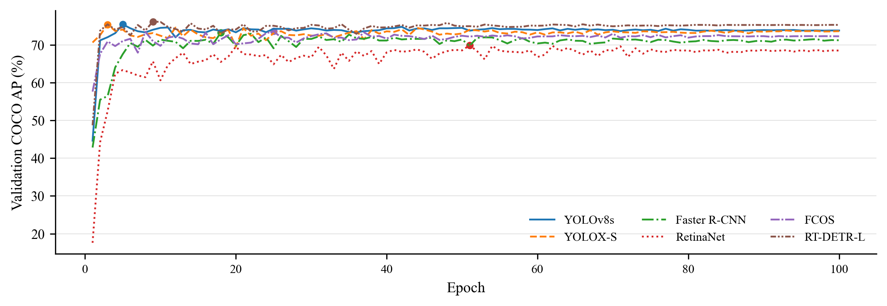
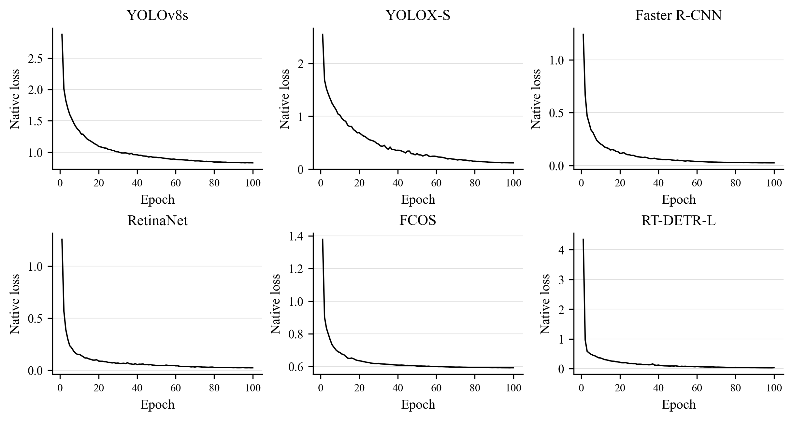
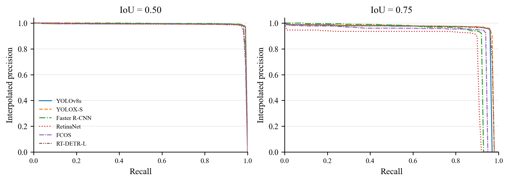
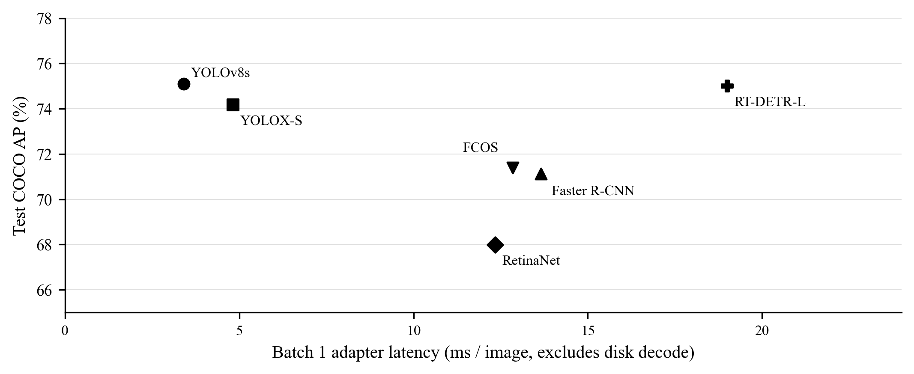
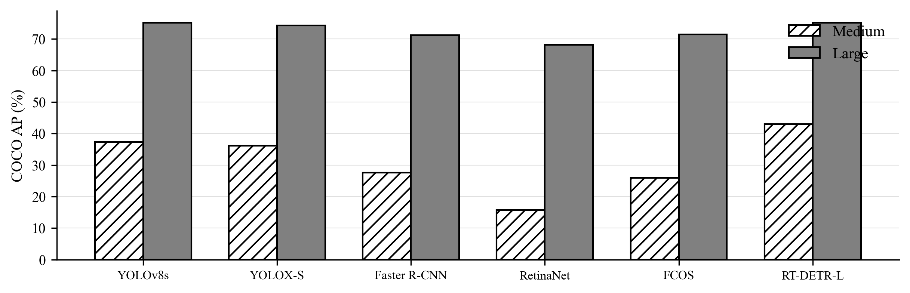

# 猪只目标检测实验结果

批次：20261021_164039_171581；设备：NVIDIA GeForce RTX 3090。

以下分数由同一批既有预测文件核对。AP/AP50/AP75/AR100 为百分数；耗时为 batch=1 的预处理、模型与后处理均值，不含磁盘解码，不是论文端到端 FPS。

| 方法 | AP | AP50 | AP75 | AR100 | ms/图 | 最佳验证轮次 |
| --- | ---: | ---: | ---: | ---: | ---: | ---: |
| YOLOv8s | 75.09 | 98.48 | 93.97 | 81.19 | 3.41 | 5 |
| YOLOX-S | 74.16 | 98.34 | 95.01 | 79.93 | 4.82 | 3 |
| Faster R-CNN | 71.13 | 98.58 | 90.31 | 76.11 | 13.66 | 18 |
| RetinaNet | 67.99 | 98.03 | 84.70 | 74.68 | 12.34 | 51 |
| FCOS | 71.40 | 98.03 | 90.69 | 77.52 | 12.85 | 25 |
| RT-DETR-L | 75.00 | 98.39 | 94.63 | 81.76 | 19.00 | 9 |

测试集 133 张、1,289 个框，其中小目标 0 个，中目标 4 个，大目标 1,285 个。AP_small=-1 表示无定义，不能写成 0。
当前是同场景编号分块的探索性验证，不能证明新场景泛化或无语义近重复。单次 seed=42 没有统计显著性证据。
训练损失来自各自原生模型，数值尺度不可直接横向排序。验证曲线均采用统一 pycocotools COCO AP。

